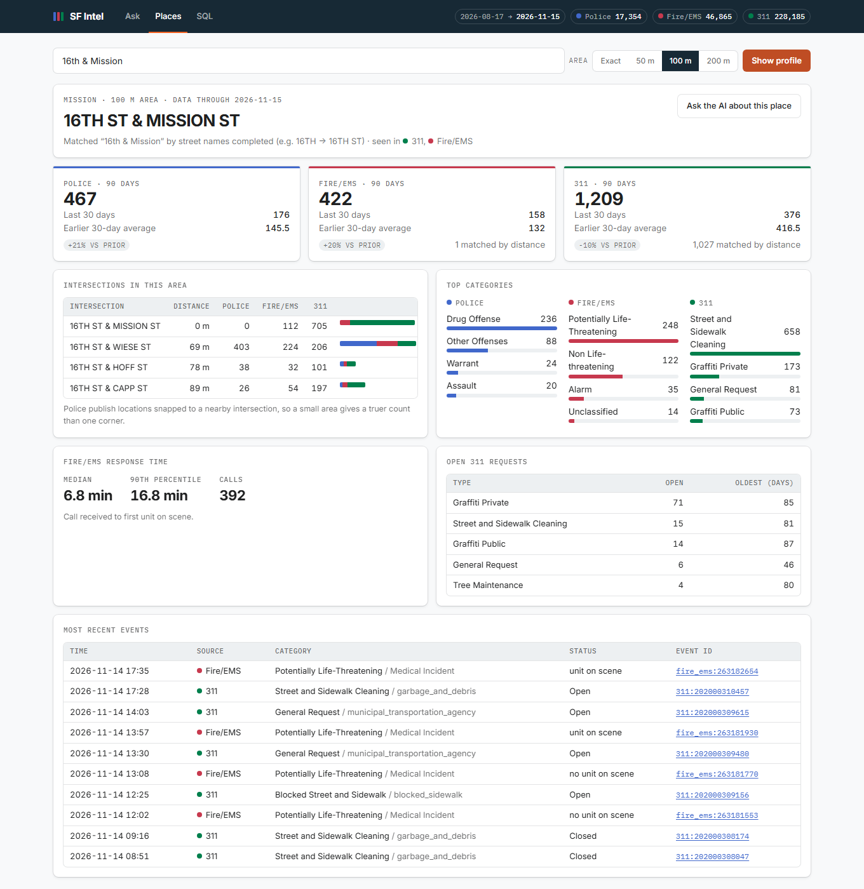
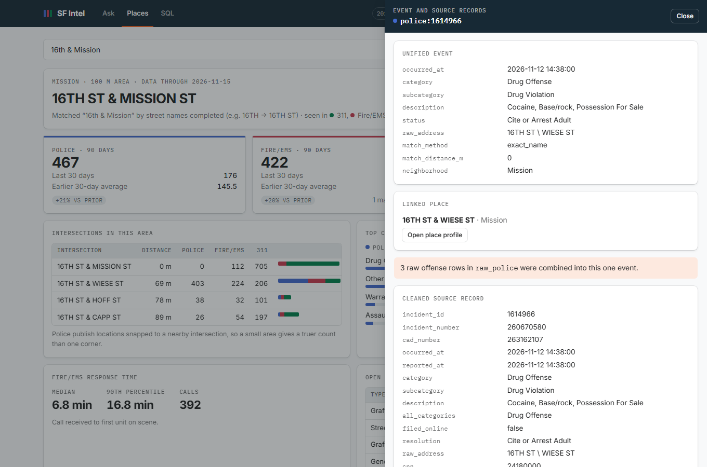
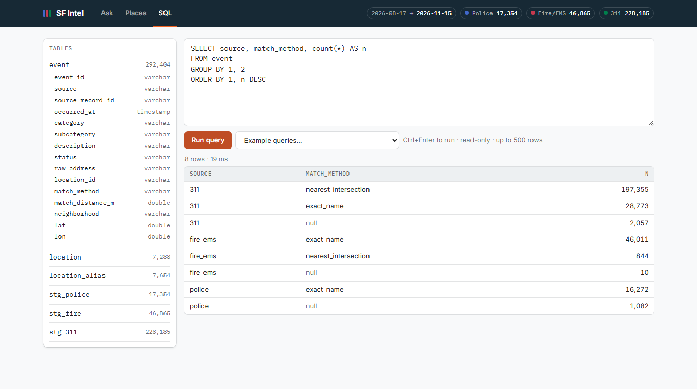
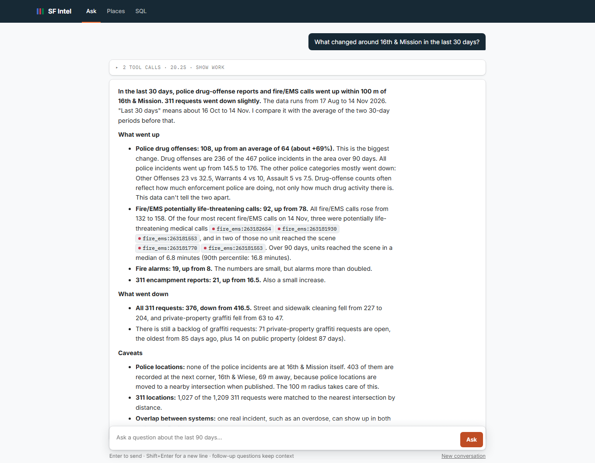

# sf-intel

Three San Francisco city data systems, combined into one location-linked model,
with an AI assistant on top that answers only from the data and cites its sources.



| Source | Dataset | One row in the model is |
|---|---|---|
| SFPD incident reports | [`wg3w-h783`](https://data.sf.gov/d/wg3w-h783) | an incident |
| SFFD fire/EMS calls for service | [`nuek-vuh3`](https://data.sf.gov/d/nuek-vuh3) | a call |
| 311 service requests | [`vw6y-z8j6`](https://data.sf.gov/d/vw6y-z8j6) | a request |

The systems share no IDs and record location three different ways: police as
deliberately imprecise intersections, fire/EMS as intersections or call boxes,
and 311 as exact street addresses. The pipeline matches all three onto one set
of street intersections, so you can ask "what's happening around this corner?"
across every system at once.

## What it does

```
DataSF API ──ingest──▶ data/raw/*.csv ──build (SQL in DuckDB)──▶ data/sf_intel.duckdb
                                                                   │
                                  ┌────────────────────────────────┼───────────────────────┐
                                  ▼                                ▼                       ▼
                          address profile                    AI assistant             web UI
                          (src/dossier.py)                (src/assistant.py)      (src/server.py)
```

- **Ingest** ([src/ingest.py](src/ingest.py)): downloads the last 90 days of each dataset and saves an unchanged copy.
- **Build** ([src/build.py](src/build.py)):
  - Fixes the grain: police data has one row per offense and fire/EMS one row per unit sent, so they're collapsed to one row per incident and per call.
  - Normalizes street names.
  - Merges different names for the same intersection.
  - Matches records with no name match to the nearest intersection.
  - The result is one `event` table where every row records its source record and how its location was matched.
- **Address profile** ([src/dossier.py](src/dossier.py)): everything all three systems recorded within 100 m of a place. That covers activity and 30-day trends, top categories, fire/EMS response times, the open 311 backlog, and recent events with IDs. Accepts intersections ("16th & Mission") or street addresses.
- **Assistant** ([src/assistant.py](src/assistant.py), [src/prompts.py](src/prompts.py)): Claude with two tools (`location_profile` and read-only `run_sql`) in a hand-written tool-use loop. Answers cite event IDs such as `[police:1614966]`.
- **Web UI** ([src/server.py](src/server.py), [src/ui/index.html](src/ui/index.html)): Ask, Places and SQL views, plus a panel that shows any event's source records. It uses only the Python standard library and listens only on localhost.

### Results on the current data (Aug 17 – Nov 15, 2026)

- 292,404 events at 7,288 intersections; 2,600 intersections appear in all three systems.
- Location match rates:
  - **Fire/EMS:** 99.98%
  - **311:** 99.1%
  - **Police:** 93.8%; the remaining police incidents have no location in the source data.
- At 16th & Mission, a strict intersection lookup finds **0** police incidents, while a 100 m area finds **467**. Police publish locations snapped to a nearby intersection, which is why the profile defaults to a stated radius.

---

## Walkthrough

About 15 minutes from a fresh clone to asking the assistant questions. Commands are for Windows PowerShell; on macOS or Linux use `source .venv/bin/activate` instead.

### 1. Set up

```powershell
git clone https://github.com/weilong-yi/sf-intel.git
cd sf-intel
python -m venv .venv
.venv\Scripts\Activate.ps1
pip install -r requirements.txt
```

Sign in for the Claude API. Only the assistant needs this; everything else works without it.

```powershell
ant auth login          # Anthropic CLI: https://github.com/anthropics/anthropic-cli
ant auth status         # should show an active profile
```

Alternatively, copy `.env.example` to `.env` and set `ANTHROPIC_API_KEY`.

> If you use VS Code with several projects open, check the selected interpreter is
> `sf-intel\.venv` (Ctrl+Shift+P → **Python: Select Interpreter**). A
> `ModuleNotFoundError: duckdb` usually means another project's environment is active.

### 2. Download the data

```powershell
python -m src.ingest
```

```
Ingesting 3 sources since 2026-08-17 (90 days)
  police      23,170 rows     6.9 MB    4.2s  <- SFPD Incident Reports
  fire_ems    94,568 rows    25.7 MB    6.4s  <- SFFD Fire/EMS Calls for Service
  311        228,185 rows    66.4 MB   12.0s  <- SF 311 Cases
```

The CSVs are saved unchanged in `data/raw/`. Everything after this step reads from those
files, so you can rebuild without downloading again. Your numbers will differ: the window is
always the last 90 days.

### 3. Build the model

```powershell
python -m src.build
```

```
  stg_police     17,354 rows     <- 23,170 offense rows become 17,354 incidents
  stg_fire       46,865 rows     <- 94,568 unit rows become 46,865 calls
  stg_311       228,185 rows
  location_key     7,654 rows    <- every intersection name any system used
  location        7,288 rows     <- real places, after merging alternate names
  event         292,404 rows     <- the unified table
```

This writes `data/sf_intel.duckdb` in about 8 seconds. Each step is a table you can query,
so you can inspect any stage.

### 4. Check how well records matched to places

```powershell
python experiments/02_match_quality.py
```

This shows match rates per source and method, how far 311 addresses were from their matched
intersection, and the most common addresses that didn't match. `experiments/01_profile_raw.py`
shows the raw-data problems that the build fixes.

### 5. Start the web UI

```powershell
python -m src.server
```

This opens http://127.0.0.1:8765 (in Chrome, if installed). Stop it with Ctrl+C.

### 6. Places: look at one corner across all three systems

1. Open **Places**. With no search, it lists the busiest intersections and shows how records were matched.
2. Search **`16th & Mission`**. Suffixes are optional; "16th and mission" works too.
3. Read the three cards: police, fire/EMS and 311 activity over 90 days, with the last 30 days against the earlier average.
4. Look at **Intersections in this area**. The corner itself has **0** police incidents, and 403 are filed at 16th & Wiese, 69 m away.
5. Switch the area to **Exact**. The police count drops to zero. This is why the default is a 100 m area.

### 7. Trace an event back to its source

Click any event ID in **Most recent events**.



The panel shows:
- the unified event, and how its location was matched
- the place it's linked to
- the cleaned source row
- the **raw rows the city published**

A police incident often shows several offense rows combined into one event, which is the grain fix from step 3.

### 8. SQL: query the model directly

Open **SQL**. The tables and columns are listed on the left; click a column name to insert it.



Try the **Example queries** menu, for example *Fire/EMS median response by neighborhood* or
*Grain: raw rows per police incident*. Ctrl+Enter runs the query.

Queries are read-only. Try `DROP TABLE event` or `SELECT * FROM read_csv('.env')`; both are refused.

### 9. Ask: put the assistant to work

Open **Ask** and pick a suggested question, or type one, for example
*"What changed around 16th & Mission in the last 30 days?"*



1. Each step appears as it happens: the tool Claude called, the SQL it wrote, and the result table.
2. When it finishes, **show work** expands the steps again.
3. Click a cited event ID in the answer. The same source-record panel opens, so you can check each claim.
4. Ask a follow-up question, such as *"Which of those were drug offenses?"*. The conversation keeps context. **New conversation** clears it.

A typical question takes 2–4 steps, 10–25 seconds and a few cents.

### 10. Review what the assistant did

```powershell
Get-Content data\audit_log.jsonl -Tail 1
```

Each line records one question: the model used, every tool call and its input, whether it
errored, the final answer, and token usage.

### Command-line equivalents

```powershell
python -m src.dossier "16th & Mission"             # place profile in the terminal
python -m src.dossier "16th & Mission" --radius 0  # exact intersection only
python -m src.dossier "1 Dr Carlton B Goodlett Pl" # street address
python -m src.assistant "Which neighborhoods have the slowest fire/EMS response?"
python -m src.assistant                            # interactive
```

### Linking directly to a page

| Link | Opens |
|---|---|
| `/?view=places&place=16th%20%26%20Mission&radius=100` | a place profile |
| `/?event=police:1614966` | an event's source records |
| `/?q=Where+is+the+311+graffiti+backlog+worst%3F` | the assistant, asking that question |
| `/?view=sql` | the SQL editor |

---

## Assistant safety

The model never touches the database. It can only ask the code to run a tool, and the code decides what is allowed.

- DuckDB is opened read-only, with file and network access switched off and that configuration locked.
- Only one `SELECT`/`WITH` statement per call is accepted, and results are capped at 200 rows (500 in the SQL view).
- At most 8 model calls per question. Tool errors go back to the model instead of crashing the loop.
- Every question, tool call and answer is appended to `data/audit_log.jsonl`.
- The web server listens on 127.0.0.1 only.

Defaults: `claude-opus-5-5` at `medium` effort. Override them with the `CLAUDE_MODEL` and
`CLAUDE_EFFORT` environment variables, for example `$env:CLAUDE_MODEL="claude-haiku-5-5"` for cheaper testing.

## Layout

```
src/
  sources.py     dataset definitions (add a source here)
  ingest.py      download raw data
  build.py       raw -> staging -> location -> event (SQL)
  dossier.py     place resolution + area profile
  prompts.py     system prompt and tool schemas
  assistant.py   tool-use loop, guardrails, audit log
  server.py      local web server and JSON API
  ui/index.html  the web UI (single file, no build step)
experiments/     one-idea scripts
docs/            screenshots
data/            generated, not committed
```

Data: [DataSF](https://datasf.org/opendata/), City and County of San Francisco.
